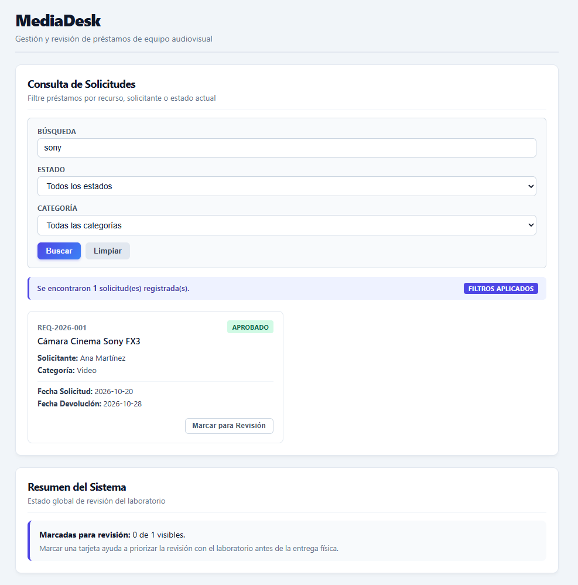
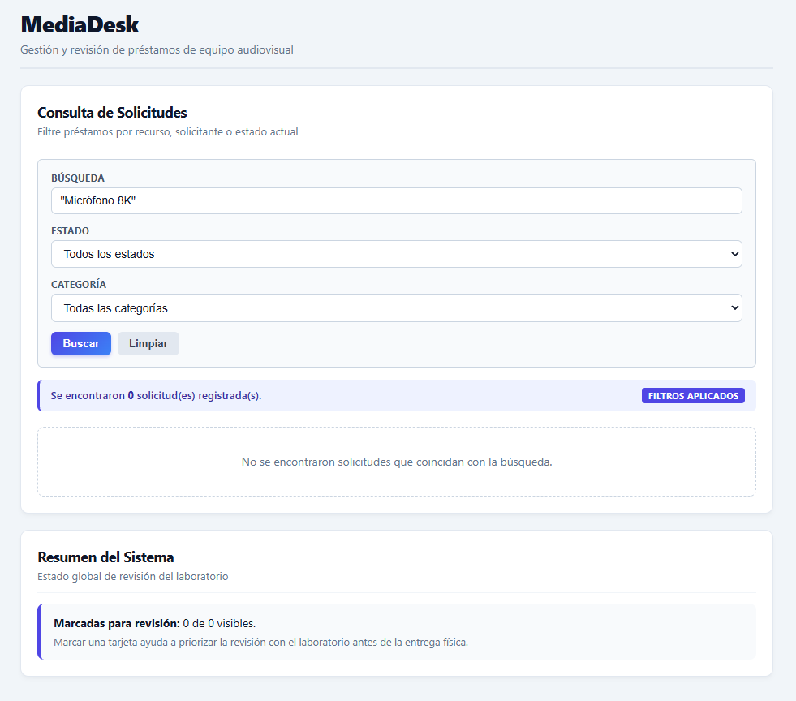
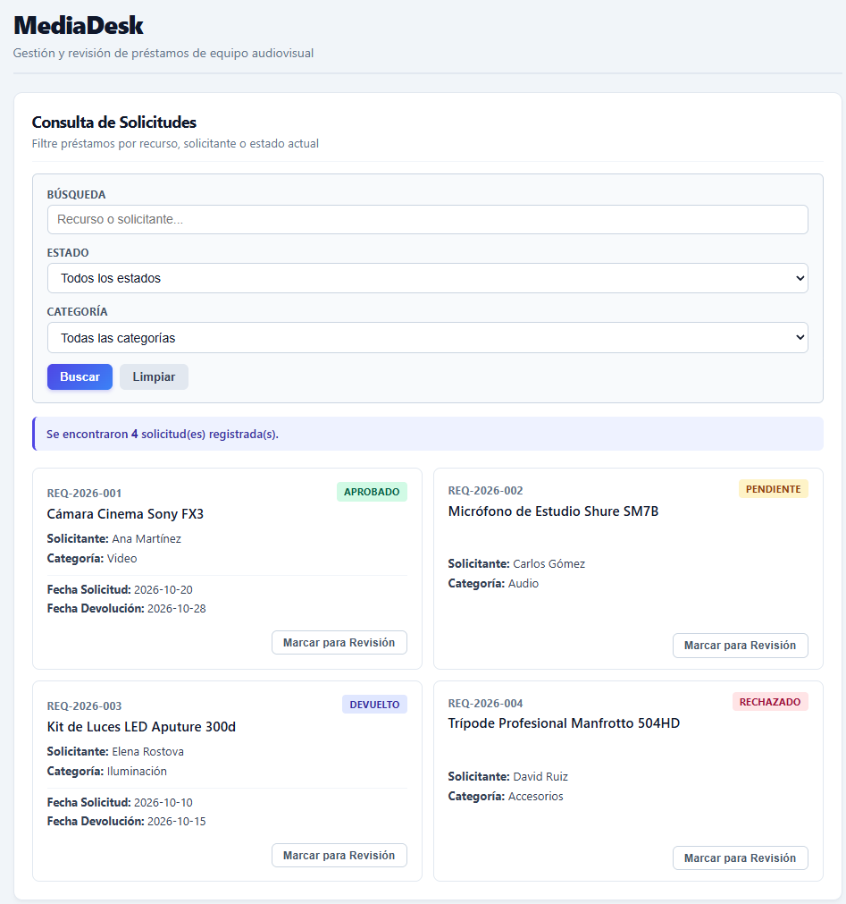
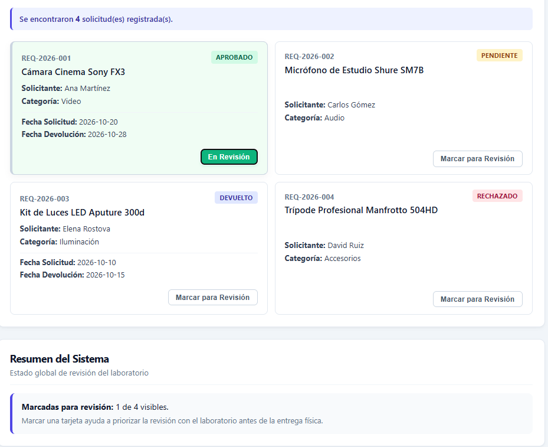
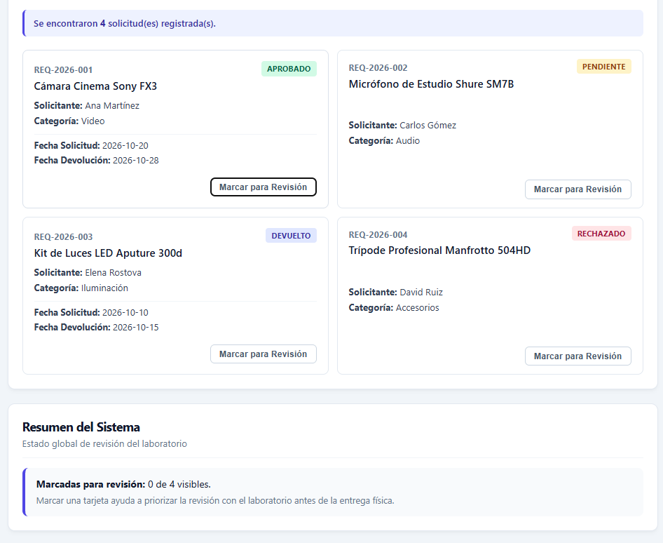

# MediaDesk - Sistema de Préstamos del Laboratorio

Este proyecto es una pequeña interfaz web hecha con **React**, **TypeScript** y **CSS Modules** para ver, buscar y marcar solicitudes de préstamo de equipos audiovisuales en un laboratorio de la universidad.

---

## 1. Estructura de carpetas

Estructuré el proyecto separando los componentes, los tipos y la lógica para que sea fácil de entender y mantener:

```text
mediadesk/
├── src/
│   ├── components/
│   │   ├── LoanRequestCard/
│   │   │   ├── LoanRequestCard.tsx
│   │   │   └── LoanRequestCard.module.css
│   │   ├── SearchForm/
│   │   │   ├── SearchForm.tsx
│   │   │   └── SearchForm.module.css
│   │   ├── StatusIndicator/
│   │   │   ├── StatusIndicator.tsx
│   │   │   └── StatusIndicator.module.css
│   │   └── WorkspaceSection/
│   │       ├── WorkspaceSection.tsx
│   │       └── WorkspaceSection.module.css
│   ├── data/
│   │   └── mockLoanRequests.ts
│   ├── hooks/
│   │   └── useLoanRequests.ts
│   ├── styles/
│   │   └── global.css
│   ├── types/
│   │   └── loanRequest.ts
│   ├── App.tsx
│   ├── App.module.css
│   └── main.tsx
├── package.json
├── tsconfig.json
└── README.md
```

---

## 2. Cómo ejecutar la aplicación

### Requisitos
- Tener instalado Node.js (versión 18 o superior).

### Pasos
1. Instalar las dependencias del proyecto:
   ```bash
   npm install
   ```

2. Iniciar el servidor de desarrollo para probarlo en el navegador:
   ```bash
   npm run dev
   ```
   Abre el enlace que sale en la consola (normalmente `http://localhost:5173`).

3. Verificar que TypeScript no tenga errores y compilar para producción:
   ```bash
   npx tsc --noEmit
   npm run build
   ```

---

## 3. Explicación de las decisiones de código y tipos

### Props requeridas vs. props opcionales
- En el componente `LoanRequestCard`, la prop `request` es **requerida** porque la tarjeta necesita los datos de la solicitud para poder renderizarse.
- La prop `variant` es **opcional**. Le puse un valor por defecto (`variant = 'detailed'`) para que, si no se envía al usar el componente, la tarjeta se muestre completa sin romper el diseño.

### Tipado de eventos del DOM
Para los controles del formulario usé los tipos que provee React:
- En el campo de texto usé `React.ChangeEvent<HTMLInputElement>`.
- En los desplegables (`<select>`) usé `React.ChangeEvent<HTMLSelectElement>`.
- En el botón de enviar del formulario usé `React.FormEvent<HTMLFormElement>` junto con `e.preventDefault()` para evitar que la página se refresque al hacer la búsqueda.

### Uso de `children` (normal y como función)
- **`WorkspaceSection`**: Usa `children: React.ReactNode` para servir como una caja o contenedor reutilizable. La usé dos veces en la pantalla principal: una para guardar el buscador con la lista de tarjetas, y otra para mostrar la sección de resumen.
- **`StatusIndicator`**: Recibe una función como hijo (`children: (state: StatusState) => React.ReactNode`). Esto sirve para que el componente le pase al padre la información de si está filtrando o cuántos resultados hay, y el padre decida cómo mostrar el mensaje.

### Manejo de fechas ausentes
Hay solicitudes (como los registros pendientes o rechazados) que aún no tienen una fecha de devolución confirmada. En lugar de dejar el campo vacío o poner un texto duro, en el tipo `LoanRequest` definí `returnDate: string | null`. Cuando viene en `null`, en la tarjeta muestro el texto *"No confirmada"*.

---

## 4. Escenarios probados

Realicé las siguientes pruebas en la pantalla de la aplicación:

1. **Búsqueda con coincidencias:** Escribí `"Sony"` en la búsqueda. El indicador cambió a *"Se encontraron 1 solicitud(es) registrada(s)"* y mostró la tarjeta de la cámara Sony FX3.



2. **Búsqueda sin coincidencias:** Escribí `"Micrófono 8K"`. El contador cambió a `0` y apareció un mensaje indicando que no se encontraron resultados.



3. **Búsqueda vacía / Limpiar:** Borré el texto y presioné **Buscar** (o el botón **Limpiar**). La lista volvió a mostrar las 4 solicitudes originales.



4. **Marcar para revisión:** Al presionar el botón *"Marcar para Revisión"* en una tarjeta, esta cambia a color verde y el botón dice *"En Revisión"*. En el panel de abajo, el contador de elementos marcados sube. Si se vuelve a presionar, la marca se quita correctamente.





---

## 5. Prueba de error de TypeScript

Para probar que los tipos de TypeScript están funcionando correctamente e impiden usar valores no válidos, intenté pasar una variante no permitida en la tarjeta:

```tsx
// Ejemplo de prueba que da error de compilación:
<LoanRequestCard onToggleReview="{toggleReviewMark}" request="{request}" variant="invalid-variant"/>
```

Al intentar compilar, TypeScript marca el siguiente error:
> `Type '"invalid-variant"' is not assignable to type 'CardVariant | undefined'.`

Esto demuestra que el contrato no permite usar opciones que no estén definidas previamente en el tipo `CardVariant`.